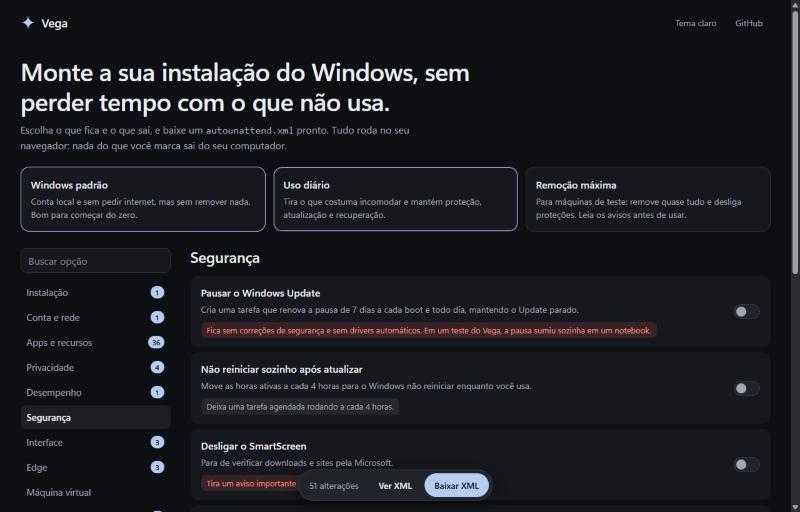

<div align="center">

# 💫 Vega

**Windows, sem os brindes.** Marque o que fica e o que sai, com todas as opções **organizadas** e o custo de cada uma, e baixe um `autounattend.xml` que deixa a instalação no automático. Tudo roda no seu navegador.



<br><br>

[](https://erickfuzer.github.io/Vega/)

</div>

> [!NOTE]
> O Vega está no começo. Os perfis Uso diário e Remoção máxima já instalaram o Windows do começo ao fim em uma máquina virtual, mas ainda não em um computador de verdade, como explica [Limitações](#limitações). Teste o arquivo gerado em uma máquina virtual antes de usar no seu computador, e relate o que encontrar em [Issues](https://github.com/erickfuzer/Vega/issues).

## Funcionalidades

- **Organizado por categoria:** instalação, disco, conta e rede, apps, privacidade, desempenho, segurança, interface e teclado, aparência, Edge, máquina virtual e avançado, com um contador do que mudou em cada uma
- **Busca:** encontre qualquer opção pelo nome ou pela descrição, com ou sem acento, sem precisar saber em qual categoria ela está
- **Todas as opções do motor:** contas prontas, login automático, políticas de senha, Wi-Fi, fuso, chave do produto, cores, papel de parede, Menu Iniciar, ícones, AppLocker, componentes XML e scripts nas quatro etapas
- **Modo de desempenho:** efeitos visuais e planos Alto Desempenho e Desempenho Máximo
- **Remoção completa do Edge:** roda no primeiro login, bloqueia a reinstalação e mantém o WebView2
- **Salvar, abrir e compartilhar:** salve em um arquivo, reabra um XML do Vega ou do gerador original, ou copie um link que não leva senhas nem chaves
- **Três formas de baixar:** o `autounattend.xml`, o mesmo arquivo dentro de uma `.iso` para máquinas virtuais, ou o nome `notautounattend.xml`, para o pendrive não iniciar a instalação sozinho
- **Campos conferidos antes de gerar:** valores que só falhariam na instalação, depois de o disco ser apagado, viram uma mensagem em português
- **Perfis prontos:** comece em Windows padrão, Uso diário ou Remoção máxima, e ajuste o que quiser depois. Também há "Só um usuário local", "Saída mínima" e "Limpar tudo"
- **O custo de cada opção:** avisos dizem o que quebra ou o que se perde, em vez de deixar você descobrir depois de instalar
- **Em português:** as 44 opções de ligar e desligar e os 60 itens removíveis têm nome e descrição em português
- **Conta local de verdade:** por padrão, a instalação pula a tela de rede e vai direto para criar usuário e senha, sem pedir conta Microsoft
- **Disco com segurança:** o modo normal usa a tela de discos do Windows. O modo script pergunta o disco na hora e pausa antes de formatar, e a barra de ações avisa sempre que o XML pode apagar um disco
- **Modo script:** desligar o Defender, compactar o Windows, escolher disco por critérios, formato das partições, recuperação, arquivo de paginação e scripts próprios
- **Prévia do XML:** veja e copie o arquivo antes de baixar
- **Privado:** o arquivo é gerado no seu navegador, e nada do que você marca é enviado para um servidor
- **Temas claro e grafite**, e versão para celular

## Como funciona

- O site é publicado no GitHub Pages, que só hospeda arquivos estáticos. Com o Blazor WebAssembly, o próprio gerador em C# roda dentro do navegador.
- O motor é o [unattend-generator](https://github.com/cschneegans/unattend-generator), de Christoph Schneegans, incluído como submódulo. Ele monta o XML e o valida contra o esquema do Windows, e o Vega cuida da organização e da interface.
- Os testes comparam o catálogo com o motor e **falham se o gerador ganhar uma opção de ligar e desligar ou um item removível que o site ainda não mostra**. Cada opção e cada perfil também precisam gerar um XML válido.
- Abrindo no Vega um XML baixado do gerador original e gerando de novo, o arquivo sai igual ao original, tirando o comentário do topo. Essa comparação foi feita com um arquivo real, de uma combinação de opções, e é o único caso comparado com a saída do site.
- O motor tem um bug no modo script: quando o disco e a imagem são perguntados na hora, o script ganha dois rótulos iguais, e Enter em branco na pergunta da imagem volta para a pergunta do disco. O Vega corrige isso no XML gerado, e a correção foi conferida no WinPE de uma instalação na máquina virtual.

## Como usar

1. Abra **[erickfuzer.github.io/Vega](https://erickfuzer.github.io/Vega/)**.
2. Escolha um perfil e ajuste as opções.
3. Baixe o `autounattend.xml`.
4. Coloque o arquivo na raiz de um pendrive de instalação do Windows e dê boot por ele.

> [!WARNING]
> Dependendo das escolhas, a instalação pode apagar o disco e desligar proteções do Windows. Leia os avisos e faça backup antes de instalar.

### Para desenvolver

Precisa do [.NET 10 SDK](https://dotnet.microsoft.com/download/dotnet/10.0).

```bash
git clone --recurse-submodules https://github.com/erickfuzer/Vega.git
cd Vega
dotnet run --project src/Vega.Web
```

Para rodar os testes:

```bash
dotnet test tests/Vega.Tests
```

Para conferir os XMLs sem instalar e para instalar numa máquina virtual, veja o [kit de teste](ferramentas/teste-vm/LEIA-ME.md). O [AGENTS.md](AGENTS.md) reúne a arquitetura, as decisões e o que as instalações ensinaram, para quem for continuar o projeto.

## Limitações

- **Testado só em máquina virtual:** em 8 de novembro de 2026, o Uso diário, no modo normal, e a Remoção máxima, no modo script, instalaram o Windows 11 26H2 do começo ao fim no VirtualBox, e cada um entregou o que promete. Ainda falta um computador de verdade, com Wi-Fi, bateria e drivers.
- **Escolha de disco:** no modo script, o pendrive também aparece na lista e não é recusado. Confira o disco pelo tamanho.
- **Defender:** no modo script, a proteção desliga, mas alguns serviços de monitoramento continuam rodando. Isso apareceu também no teste da Remoção máxima.
- **Pausa do Windows Update:** só começa no segundo boot. No primeiro login, o Update ainda está ligado.
- **Abrir XML:** só funciona com arquivos que trazem as opções no comentário do topo, como os do Vega e os do gerador original. O XML do Vega reabre sem senhas nem chaves.
- **Remover o Edge:** no teste da máquina virtual, o Edge saiu e o WebView2 ficou. O atalho fixado na barra de tarefas continua lá, com um ícone genérico, e links do Windows feitos só para o Edge podem parar de funcionar.
- **Plano de energia:** alguns notebooks não têm Alto Desempenho nem Desempenho Máximo e continuam em Equilibrado.
- **Senhas no arquivo:** senhas, chaves e o Wi-Fi digitados ficam no XML e na configuração salva. Não compartilhe esses arquivos se usar dados reais.
- **Download inicial:** o .NET vem junto com a página, cerca de 11 MB antes da compactação. As visitas seguintes usam o cache do navegador.

## Estrutura

```
Vega/
├── src/
│   ├── Vega.Core/              # catálogo em português, perfis e montagem da configuração
│   └── Vega.Web/               # interface em Blazor WebAssembly
├── tests/Vega.Tests/           # confere o catálogo contra o motor e gera os XMLs
├── vendor/unattend-generator/  # motor original, como submódulo
├── ferramentas/teste-vm/       # conferência dos XMLs e instalação em máquina virtual
├── docs/                       # prints do README
├── .github/workflows/          # publicação no GitHub Pages
├── AGENTS.md                   # guia para continuar o projeto
├── Vega.slnx
├── LICENSE
└── README.md
```

## Créditos

Motor de geração: [unattend-generator](https://github.com/cschneegans/unattend-generator), de Christoph Schneegans, sob a licença MIT. Interface feita com [Blazor](https://blazor.net). O Vega não é afiliado à Microsoft nem ao projeto original. Desenvolvido com o auxílio do [Claude](https://claude.ai) (Anthropic).

## Licença

[MIT](LICENSE): use, modifique e distribua à vontade.

<div align="center">
<sub>Feito por <a href="https://github.com/erickfuzer">Erick Fuzer</a></sub>
</div>
